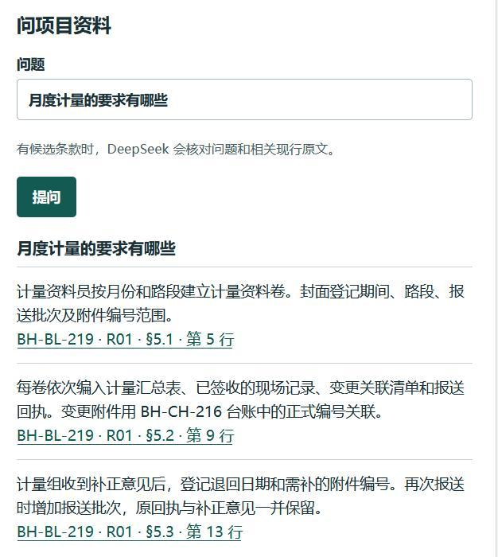

# SecureAgent · Construction Knowledge Workbench

SecureAgent helps construction staff answer a question that changes from site to site. **Which clause applies to this project today?** Staff can ask in Chinese, see the approved wording and open the original at the cited page or section. Document controllers can submit revisions and reviewers can publish them. The employee's answer then follows the new revision.

[Open the deployed workbench](https://secureagent.vercel.app/workbench) (project account required) · [中文使用指南](docs/workbench.md) · [Explore the fictional project library](docs/project_library.md)

## See it in use

A coordinator on the BH04 road project asks **“月度计量的要求有哪些？”** The workbench surfaces three clauses from **BH-BL-219 R01** covering the file cover sheet (§5.1), the order of attachments (§5.2) and resubmission after corrections (§5.3). You can check all three against the [source document](examples/project_library/BH04/BH-BL-219_R01.md).

The [demo library](docs/project_library.md) starts with **18 effective documents across three fictional projects** in housing, road construction and industrial building services. The other two revisions in the 20-version register are a draft and a superseded version. Try these two workflows.

- **Trace a missing attachment.** In BH04, ask “BH-CG-042 回执登记的待补附件是什么，由谁补交？” The receipt names the missing electronic survey-results index page and the survey records clerk who must supply it. The citation opens [the archived receipt, page 2](examples/project_library/BH04/BH-RC-307_R01.pdf).
- **Watch an answer change after approval.** In a freshly seeded XR03 housing project, §2.1 gives the filing clerk two working days. Employees see R01 while R02 is a draft. After a reviewer publishes R02, the same question cites the [one-day rule](examples/project_library/XR03/XR-DC-101_R02.md).

## How a question becomes an answer

~~~mermaid
flowchart TD
    A["Clerk uploads a draft"] --> B["Reviewer publishes a revision"]
    B --> C["Project register, original files and clauses"]
    D["Employee asks a question"] --> E["Check session and project membership"]
    E --> F["Rank current clauses in this project"]
    C --> F
    F --> G["Allowlisted project: DeepSeek selects supporting clause IDs per subquestion"]
    F --> H["Search mode: show ranked excerpts"]
    G --> I["Recheck access and revision, then quote sources or mark insufficient evidence"]
    H --> J["Employee opens a cited original"]
    I --> J
~~~

The hosted retriever combines Chinese character-bigram matching with embeddings from a quantized **BGE-small-zh-v1.5** model running on CPU through ONNX Runtime. Reciprocal rank fusion merges the two rankings and keeps up to three candidates. DeepSeek receives the question and eligible excerpts for configured projects. The server validates selected IDs and displays stored text. When evidence cannot establish a fact, that part of the answer can say so. [Retrieval implementation](app/search_construction.py) · [Evidence selection](app/answer_construction.py) · [Workbench request path](app/workbench.py)

## Who can do what

| Role | Responsibility |
| --- | --- |
| Company administrator | Manages accounts, project memberships and project lifecycle. Reading a project's documents requires a project role. |
| Document clerk | Submits numbered Markdown, text PDFs or DOCX files as drafts and checks the extracted clauses against the original. |
| Reviewer | Checks the draft and expected current revision, then approves publication. The previous effective revision is superseded in the same transaction. |
| Employee | Searches current documents in assigned projects and follows citations to a PDF page, Word block or Markdown line. |

Project access and revision state are checked again when results come back and when an original is opened. A separate [tool-permission example](app/document_tool.py) exercises the intersection of employee and task scope before a read and records request and tool-call IDs. [Workbench tests](tests/test_workbench.py) · [Tool tests](tests/test_document_tool.py)

## What the evaluation measures

The [versioned retrieval fixture](evals/retrieval/README.md) contains seven clauses from two projects and twelve Chinese questions. Nine have a labeled supporting clause. The figures below use those nine and fixture fingerprint `8dee86ff2c09`.

| Retrieval method | Correct clause at rank 1 | Correct clause in top 3 | MRR@3 |
| --- | ---: | ---: | ---: |
| Character-bigram matching | 6/9 | 8/9 | 0.778 |
| Lexical + BGE, fused with RRF | 9/9 | 9/9 | 1.000 |

Both methods returned candidates for all three questions without supporting evidence. In a separate recorded run of the [single-citation DeepSeek evaluation](evals/answer_quality.py), the model cited the labeled clause for **8/9** answerable questions and abstained on **3/3** unsupported questions. It also abstained on one paraphrase whose correct clause ranked first. These counts describe this small fixture.

## Run the demo locally

Use Python 3.12. Run the following in Windows Command Prompt.

~~~bat
git clone https://github.com/ChenYilyc/SecureAgent.git
cd SecureAgent
py -3.12 -m venv .venv
.\.venv\Scripts\activate.bat
python -m pip install -r requirements.txt
python -m app.demo_projects
python -m app.workbench_accounts demo --project BH04
python -m uvicorn app.main:app --host 127.0.0.1 --port 8000
~~~

On macOS or Linux, create the environment with `python3.12 -m venv .venv` and activate it with `source .venv/bin/activate`. Open [the local workbench](http://127.0.0.1:8000/workbench), sign in as `demo-employee` with the password printed on first creation and try the BH04 receipt question above. This path uses SQLite and lexical search and works without a model API key. The [Chinese guide](docs/workbench.md) covers enabling hybrid retrieval and opting projects into DeepSeek.

To reproduce the retrieval comparison, prepare the pinned embedding model once, then run the evaluation. The last command runs the application tests.

~~~console
python -m app.semantic_retrieval prepare
python -m evals.retrieval_baseline --compare
python -m unittest discover -s tests -v
~~~

## Deployment and storage

The browser workbench is HTML, CSS and JavaScript served by a Python/FastAPI application on Vercel. The server connects to Supabase PostgreSQL through psycopg. Accounts, project grants, original file bytes and SHA-256 digests, document versions, clause locations and audit events are stored in PostgreSQL. Embeddings are a rebuildable cache in the Vercel instance's temporary storage. The hosted account and document data stay in the database across application deployments. [Vercel configuration](vercel.json) · [Database migrations](supabase/migrations) · [Document storage](app/postgres_documents.py)

The sample company and project records are fictional and are included for demonstration. Scanned PDFs need OCR before upload. The current retriever compares embeddings within the authorized project, so a useful scaling experiment is to measure latency and recall with a larger clause set before moving vector search into PostgreSQL.
